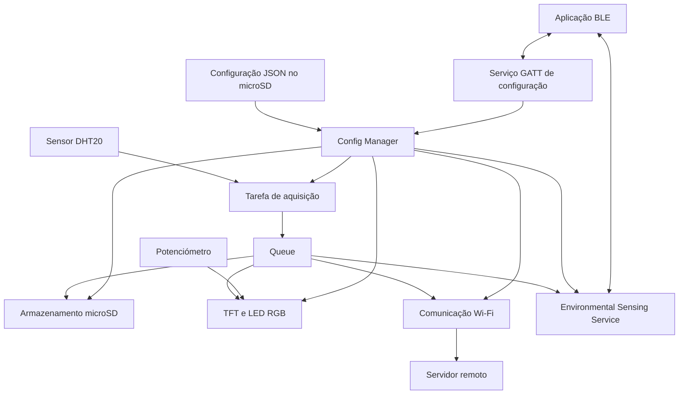

# EcoNode — Arquitetura do Projeto

---
## 1. Objetivo e plataforma
O EcoNode é um nó autónomo de monitorização ambiental.

|Aspeto|Detalhe|
|---|---|
|Placa|**ESP32-C6 DevKitC-1**|
|Framework|**ESP-IDF v6.1.0**|
|Medições|Temperatura e humidade (sensor DHT20)|
|Apresentação local|Ecrã TFT e LED RGB|
|Registo local|Cartão microSD|
|Disponibilização remota|Wi-Fi (MQTT ou WebSocket) e Bluetooth Low Energy (BLE)|

### 1.1 Princípio fundamental

> [!important] Tolerância a falhas
>  A aquisição e o registo local **têm de continuar a funcionar** quando a rede ou o servidor estão indisponíveis.

Os parâmetros operacionais devem ser consultados sempre através da interface pública do módulo de configuração.

---
## 2. Vista geral da arquitetura
O firmware deve ser organizado em módulos com responsabilidades delimitadas e interfaces públicas `.h`, evitando dependências desnecessárias entre implementações.



> [!note] A figura representa **relações lógicas**, não uma correspondência obrigatória entre cada módulo e uma tarefa FreeRTOS. A aquisição deve ter uma tarefa dedicada; a divisão das restantes deve evitar bloqueios entre funcionalidades.

---
## 3. Aquisição e interface local
### 3.1 Sensor DHT20

O módulo `sensor_dht20` encapsula a comunicação com o sensor e expõe funções de inicialização e aquisição de amostras.
- A tarefa de aquisição funciona com um **período configurável entre 1 e 3600 segundos**.
- Cada amostra contém temperatura, humidade e os metadados necessários aos restantes módulos.
- A entrega das amostras usa uma **Queue**, conforme a especificação e a decisão do grupo.
- Devem ficar documentados: a **capacidade** do mecanismo, o **tamanho das mensagens** e o **comportamento quando fica cheio**.
- A aquisição **nunca** pode ficar bloqueada indefinidamente à espera de outros módulos.
### 3.2 TFT, LED RGB e potenciómetro

**Módulo `display`** — apresenta:
- temperatura e humidade;
- estado da rede e do BLE;
- `node_id` e identificadores relevantes durante o arranque.

**Módulo `status_led`** — centraliza o controlo do LED interno da placa:

|Cor|Estado|
|---|---|
| Verde|Funcionamento normal|
| Vermelho|Erro|
| Amarelo|Transmissão|
| Azul|Provisionamento|

- A **prioridade entre estados simultâneos** deve ser documentada.
- Os restantes módulos **não** controlam diretamente os pinos do LED.

**Potenciómetro** — controla o brilho do TFT. A leitura analógica e a conversão para nível de brilho ficam encapsuladas num módulo apropriado e devem ser testadas no hardware real.

> [!warning] O ecrã **nunca** deve apresentar credenciais ou palavras-passe.

---
## 4. Armazenamento em microSD

O módulo `storage` centraliza o acesso ao cartão e gere três categorias de dados:

|Categoria|Conteúdo|
|---|---|
|**Leituras**|Registo persistente das amostras ambientais|
|**Logs**|Eventos relevantes: arranque, falhas do sensor, alterações de configuração, erros de armazenamento|
|**Configuração**|Parâmetros operacionais em formato JSON|

### 4.1 Requisitos

- Os formatos externos incluem **versionamento** (a configuração usa `config_version`).
- O registo local **não pode depender** da disponibilidade da rede.
- O acesso concorrente ao cartão deve ser controlado para evitar conflitos entre tarefas.
- Os logs **não podem** conter credenciais, palavras-passe ou outros dados sensíveis.
### 4.2 A definir pelo grupo

- Formato dos ficheiros.
- Política de rotação.
- Tratamento de cartão ausente e de erros de escrita.

---
## 5. Comunicação
### 5.1 Wi-Fi e servidor remoto

O módulo `network` gere a ligação Wi-Fi, a publicação de telemetria e as reconexões.
- A **URI completa** do servidor vem da configuração e suporta, no mínimo, `mqtt://` e `ws://`.
- A escolha do transporte depende da configuração, **sem recompilar** o firmware.
- As dependências externas (`espressif/mqtt`, `espressif/cjson`) são declaradas em `main/idf_component.yml`.
- A telemetria disponibiliza temperatura e humidade para visualização remota.
- A base de tópicos ou recursos segue o formato `econode/<node_id>/`, com os identificadores atribuídos ao grupo.
- A documentação deve justificar o transporte escolhido, considerando **overhead**, **consumo energético** e **comportamento perante falhas**.
### 5.2 Tolerância a falhas

A indisponibilidade do Wi-Fi ou do servidor **não pode interromper**:
1. a aquisição;
2. o armazenamento local;
3. a disponibilidade do BLE para consulta e configuração.

Regras para a tarefa de rede:
- usar timeouts e estratégias de reconexão que não bloqueiem as restantes tarefas;
- quando uma publicação falha, a amostra continua a ser guardada localmente;
- qualquer mecanismo de acumulação e reenvio tem **limites de memória definidos**.
### 5.3 BLE ambiental

O módulo `ble_services` disponibiliza o serviço GATT padrão **Environmental Sensing Service**.

|Elemento|UUID|Propriedades|
|---|---|---|
|Serviço Environmental Sensing|`0x181A`|—|
|Temperatura|`0x2A6E`|read, notify|
|Humidade|`0x2A6F`|read, notify|

A consulta local deve continuar disponível mesmo sem Wi-Fi.
### 5.4 BLE para configuração

Deve existir um serviço GATT **proprietário** que permita consultar ou alterar, pelo menos:
- o período de amostragem;
- as credenciais de rede;
- a URI do servidor.

**Provisionamento:** quando não existe uma configuração de rede válida, o dispositivo permite provisionamento por BLE. Os valores recebidos são **validados**, **persistidos no microSD** e **aplicados sem recompilar**.

**Padrão de UUIDs atribuído ao grupo:**

```
E0C0DE00-0000-4000-8000-00000000XXXX
```

- `XXXX` é o `node_id` em hexadecimal, com quatro dígitos.
- As características seguem o mesmo padrão, incrementando o identificador inicial.

|Elemento|Prefixo|
|---|---|
|Serviço|`E0C0DE00-…`|
|Característica 1|`E0C0DE01-…`|
|Característica 2|`E0C0DE02-…`|

---
## 6. FreeRTOS e interfaces entre módulos
### 6.1 Divisão de tarefas (indicativa)

|Tarefa|Responsabilidade|
|---|---|
|Aquisição|Ler o DHT20 periodicamente e disponibilizar as amostras|
|Armazenamento|Registar leituras e eventos no microSD|
|Interface|Atualizar o TFT, o LED e o brilho|
|Rede|Gerir Wi-Fi, publicação e reconexão|
|BLE|Gerir serviços GATT, notificações e pedidos de configuração|

> [!note] A divisão é indicativa. 
> As responsabilidades podem ser agrupadas, desde que a decisão seja **justificada** e não comprometa a independência das funcionalidades.

A aquisição entrega amostras estruturadas através da Queue ou Message Buffer definido. Os canais de comunicação têm políticas claras para **timeouts**, **saturação** e **erros**.
### 6.2 Interfaces públicas

|Cabeçalho|Responsabilidade|
|---|---|
|`config_manager.h`|Carregar, validar e consultar a configuração|
|`sensor_dht20.h`|Inicializar o sensor e obter leituras|
|`econode_data.h`|Definir estruturas de dados partilhadas|
|`storage.h`|Gerir o cartão e registar dados|
|`display.h`|Atualizar a informação visual|
|`status_led.h`|Controlar o estado indicado pelo LED|
|`network.h`|Gerir a conectividade e a telemetria|
|`ble_services.h`|Disponibilizar os serviços BLE|

Os módulos consumidores usam estas interfaces **sem aceder aos detalhes internos** de outros componentes.

---
## 7. Configuração centralizada

O `config_manager` é a **autoridade para a configuração ativa**. No arranque:
1. lê o JSON do microSD;
2. verifica `config_version`;
3. valida os campos.

Os restantes módulos consultam os parâmetros pela interface pública (por exemplo, `config_get()`).
### 7.1 Conteúdo da configuração

Conforme aplicável:
- `config_version` e `node_id`;
- período de amostragem entre 1 e 3600 segundos;
- credenciais Wi-Fi;
- URI completa do servidor (`mqtt://` ou `ws://`);
- identificadores específicos do grupo.
### 7.2 Atualizações e casos de erro

- Uma atualização recebida por BLE é **validada antes** de substituir a configuração ativa.
- O grupo define o comportamento perante: JSON inválido, versões não suportadas, cartão ausente e falhas de escrita.
### 7.3 Ficheiro de exemplo

- `config.example.json` serve **apenas** como exemplo da estrutura esperada.
- A localização efetiva da configuração depende do mecanismo de montagem e acesso ao microSD.
- Todas as credenciais presentes no repositório devem ser **fictícias**.

---
## 8. Segurança e consumo energético
### 8.1 Segurança

As credenciais devem ser protegidas em todas as interfaces:

|Interface|Regra|
|---|---|
|**TFT**|Não apresentar credenciais ou palavras-passe|
|**Logs**|Não registar valores sensíveis|
|**BLE**|As características que recebem credenciais **não permitem leitura** dos valores recebidos|
|**Configuração**|Limitar o acesso a dados sensíveis; não incluir credenciais reais no repositório nem nas evidências|

> [!warning] A especificação prevê guardar as credenciais no microSD, mas isso **não significa** que o ficheiro esteja cifrado. Qualquer proteção adicional deve ser documentada e comprovada.

### 8.2 Consumo energético

A estratégia de redução do consumo deve ser **implementada, documentada e validada através de medições**.

Parâmetros que podem ser avaliados:
- período de amostragem;
- frequência de atualização do TFT;
- intervalos entre tentativas de reconexão.

Restrições:
- as medidas não podem comprometer a aquisição, o armazenamento local nem a disponibilidade exigida do BLE;
- os resultados indicam as **condições de teste**;
- não se declaram reduções percentuais que não tenham sido medidas.

---
